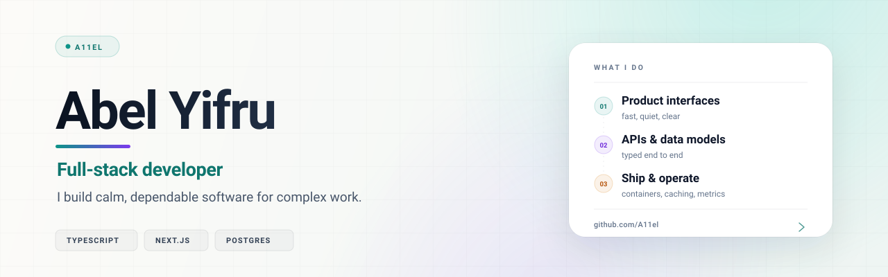
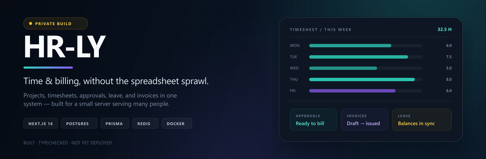
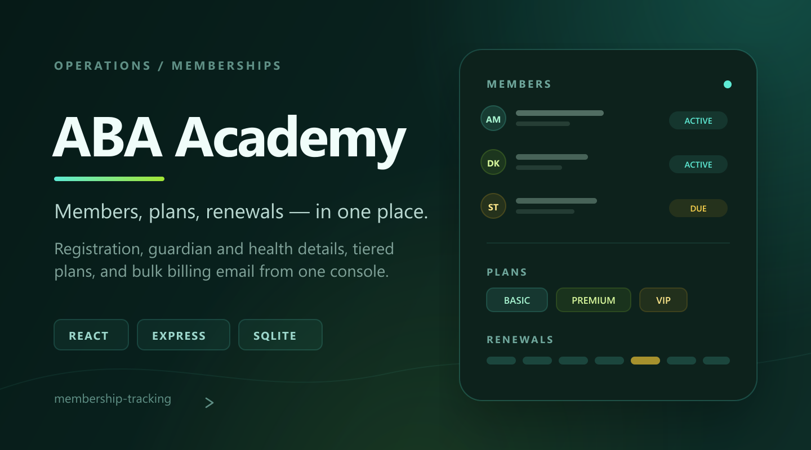

  <picture>
    <source media="(prefers-color-scheme: dark)" srcset="assets/hero-dark.svg">
    <source media="(prefers-color-scheme: light)" srcset="assets/hero-light.svg">
    
  </picture>

 

  
  &nbsp;
  

 

## A little context

I build end-to-end products — the kind where the data model, the approval flow, and the last empty state all have to agree.

My sweet spot is **operational software**: tools that replace a sprawl of spreadsheets, make the next action obvious, and earn trust by being predictable. I like typed boundaries, honest errors, fast pages, and interfaces that stay quiet until you need them.

 

## Currently building

**HR-LY** is a time-and-billing platform for project-based firms: capture project time, route it through approval, manage leave, and turn approved hours into accurate invoices.

It is a private build right now — typechecked, lint-clean, and covered at the domain level, but not yet deployed. The goal is simple: one system where the numbers stay honest from the timesheet to the invoice.

 

## Selected work

A public slice of the work — most of my recent time has gone into HR-LY.

<table>
  <tr>
    <td width="50%" valign="top">
      
      <h3>Dr. Selam <code>live</code></h3>
      
A calm, editorial website for a spine specialist and the First Spine Africa initiative — built to make expertise feel approachable and appointment requests effortless.

      
<code>React</code> <code>TypeScript</code> <code>Vite</code> <code>Tailwind</code> <code>Supabase</code>

      
<a href="https://drselamwebsite.vercel.app"><b>Visit the site</b></a> &nbsp;·&nbsp; <a href="https://github.com/A11el/drselamwebsite">Source</a>

    </td>
    <td width="50%" valign="top">
      
      <h3>ABA Academy <code>ops</code></h3>
      
A membership workspace for a youth academy: registration, guardian and health details, tiered plans, renewals, and bulk billing email from one console.

      
<code>React</code> <code>Express</code> <code>SQLite</code> <code>Sequelize</code> <code>Nodemailer</code>

      
<a href="https://github.com/A11el/membership-tracking"><b>View the repository</b></a>

    </td>
  </tr>
</table>

More experiments and earlier work live in the <a href="https://github.com/A11el?tab=repositories">repositories</a>.

 

## Toolbox

  <picture>
    <source media="(prefers-color-scheme: dark)" srcset="https://skillicons.dev/icons?i=ts%2Cjs%2Creact%2Cnextjs%2Castro%2Ctailwind%2Cnodejs%2Cexpress%2Cpostgres%2Cprisma%2Credis%2Cdocker%2Cnginx%2Clinux%2Cgit%2Cgithub%2Cpy%2Cjava&amp;theme=dark&amp;perline=9">
    <source media="(prefers-color-scheme: light)" srcset="https://skillicons.dev/icons?i=ts%2Cjs%2Creact%2Cnextjs%2Castro%2Ctailwind%2Cnodejs%2Cexpress%2Cpostgres%2Cprisma%2Credis%2Cdocker%2Cnginx%2Clinux%2Cgit%2Cgithub%2Cpy%2Cjava&amp;theme=light&amp;perline=9">
    
  </picture>

 

I reach for **TypeScript** by default, keep the data close to **PostgreSQL**, and like the boring parts of shipping: typed contracts, clear failure states, useful logs, and a deploy that behaves the same way twice.

 

---

  
<i>Build with care. Ship with evidence.</i>

  
    
  

