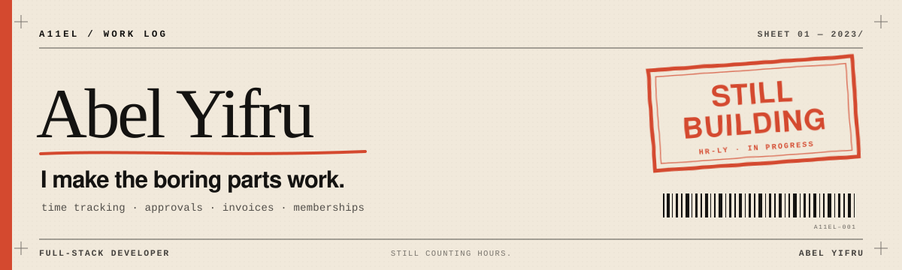

  

## This isn't a personal brand. It's a work log.

I'm Abel. I build the parts of software that people only notice when they're wrong: time tracking, approvals, invoices, memberships, records.

I'm less interested in making a dashboard look busy than in the moment someone opens it, sees what to do next, and closes it again.

> **Now:** **HR-LY** — a time-and-billing system for project teams. Private, typechecked, not deployed. That's the honest status.

## Work log

### HR-LY · 2026 to now
`private` `in progress`

Time tracking, approvals, leave, and invoicing. The interesting problem isn't the timesheet grid; it's making the numbers agree from entry to invoice.

### Dr. Selam · March 2026
`live`

A website for a spine specialist and First Spine Africa. The goal was simple: make it easy to trust the doctor and easy to book.

[Visit the site](https://drselamwebsite.vercel.app) · [Source](https://github.com/A11el/drselamwebsite)

### ABA Academy · January 2026
`source`

Memberships, guardian details, renewals, and billing emails for a youth academy. One console instead of a folder of forms.

[Source](https://github.com/A11el/membership-tracking)

## Notes to self

- If the total is wrong, nothing else matters.
- An empty state is not a corner case.
- A dashboard should tell you what to do next, not how busy you are.
- "We'll fix it later" is how spreadsheets happen.

## Colophon

Lately: TypeScript, Next.js, PostgreSQL, Prisma. Docker when it earns its keep.  
Earlier: Java, Python, and several lessons.

 

  END OF SHEET 01 · <a href="https://github.com/A11el">A11EL</a>

